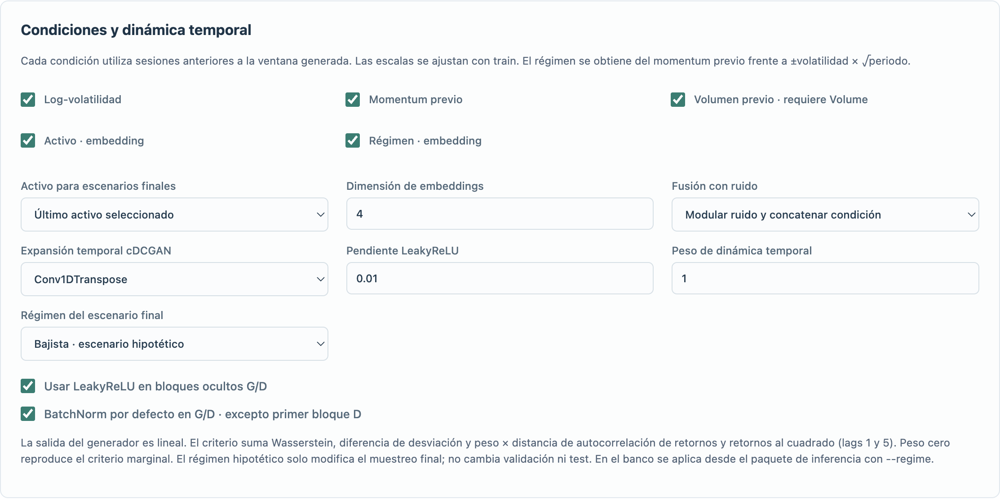

# GAN temporal y condiciones financieras · 1.5.0

Implementación inspirada en las arquitecturas DCGAN y Conditional GAN de los capítulos 4 y 8 de *GANs in Action* aportados por el usuario. La adaptación opera sobre ventanas de retornos diarios, no sobre imágenes.

## Dónde configurarlo

En **Infografías U2–U10 → Unidad 9**, seleccionar CVAE, CGAN y/o CDCGAN. La configuración existente se conserva; si CDCGAN no aparece activado tras actualizar, marcarlo o restablecer el preset U9.

1. Seleccionar OHLC diarios. Para probar todas las condiciones, la demo incluye Volume.
2. Elegir horizonte, ruido latente y condiciones. Comenzar con prueba rápida o pocas épocas.
3. Configurar G/D: filtros, kernel, stride 1–4, capas 1–5, normalización, dropout y optimizadores independientes. El ancho de proyección del generador controla los canales iniciales de la cDCGAN.
4. Comprobar y ejecutar. Comparar resultados de validación y leer los diagnósticos de test.

En **Banco de variantes → Escenarios**, cDCGAN 1D participa como familia independiente. Las capas y anchos se muestrean del espacio de búsqueda; el resto de los controles generativos se mantiene fijo durante esa búsqueda.

## Arquitecturas

- **cGAN:** generador y discriminador densos, condicionados.
- **cDCGAN:** proyección del ruido y condición → tensor tiempo × canales → Conv1DTranspose o UpSampling1D + Conv1D → salida lineal de retornos. El discriminador recibe retornos y condición repetida como canales, y usa Conv1D con salida logit.
- **CVAE:** encoder con ventana y condiciones; decoder condicionado. Conserva reconstrucción MSE + beta KL.

El generador se recorta al horizonte exacto cuando la expansión por strides produce una longitud mayor. No se fuerza `tanh` en la salida ni se recortan los retornos a [-1,1]. Las capas usan componentes Keras nativos, sin Lambda ni objetos personalizados para recargar el modelo.

BatchNorm se puede configurar globalmente y por capa; se omite siempre en el primer bloque del discriminador. Las estadísticas de G no se actualizan durante el paso de D, ni las de D durante el paso de G. LeakyReLU dispone de pendiente configurable; al desactivar el interruptor global se respeta la activación de cada capa. Los kernels y strides solo afectan al modelo convolucional, aunque se comparen ambas familias.

## Condiciones y ausencia de anticipación

Se usa exclusivamente el periodo anterior al comienzo de la ventana objetivo:

- Volatilidad: log de la desviación de retornos previos.
- Momentum: suma de retornos log previos.
- Volumen: media de log(1 + Volume); exige volumen finito y no negativo.
- Activo: categoría según el orden de activos seleccionados, con embedding aprendido.
- Régimen: bajista, lateral o alcista según momentum previo frente a ±desviación previa × raíz del periodo. No se etiqueta con el retorno futuro.

Cada condición continua se escala con train. Las categorías no se estandarizan. El esquema exportado registra nombres, orden, medias, escalas, vocabulario y regla de régimen. Los embeddings son independientes en G/D. La condición se concatena con el ruido o lo modula antes de concatenarla; D recibe la condición además de la ventana.

El muestreo final permite elegir activo y un régimen observado o hipotético. Cuando se activa régimen, U9 compara los tres escenarios con **idéntico ruido** y las mismas condiciones continuas; exporta esas ventanas en JSON. Esto es sensibilidad a una etiqueta, no una estimación de probabilidad de que ocurra ese régimen. Una combinación hipotética puede estar poco representada en entrenamiento.

## Evaluación

El criterio de validación, con ruido fijo, suma:

`Wasserstein + |std real − std generada| + peso temporal × distancia ACF`

La distancia temporal es la media de diferencias absolutas de autocorrelación para retornos y retornos al cuadrado, lags 1 y 5 cuando el horizonte lo permite. Se calcula dentro de las ventanas, sin concatenar activos. Peso cero conserva el criterio marginal anterior. Todos los candidatos de una búsqueda comparten el peso.

En test se reportan distribución, colas, ACF, ACF de retornos al cuadrado, diversidad y resultados por régimen observado. Los grupos con menos de ocho ventanas no producen diagnóstico de distribución. La fracción de ventanas distintas y la dispersión entre escenarios detectan degeneración evidente; no prueban cobertura o ausencia de colapso de modos. Las ventanas solapadas no son muestras independientes.

El test no interviene en selección de épocas o variantes. Entrenamiento mezcla únicamente ventanas completas de train, emparejadas con sus condiciones.

## Exportación e inferencia

El banco exporta generador/discriminador Keras, arquitecturas, pesos NPZ, escalas, esquema de condiciones, contexto, métricas, hashes y script. Ejemplo dentro del paquete extraído:

```bash
python bot_infer.py --bundle . --asset 0 --scenarios 64 --regime 0
```

`--regime`: 0 bajista, 1 lateral, 2 alcista; omitirlo usa el observado. Solo se admite si el modelo fue entrenado con esa condición. Las ejecuciones con la misma semilla y número de escenarios conservan el ruido para comparar regímenes. Los paquetes previos con condición escalar de volatilidad siguen admitidos.

Esta versión genera ventanas por activo. **No implementa un generador multiactivo conjunto ni correlaciones cruzadas entre trayectorias de activos.** Tampoco calibra probabilidades de pérdidas ni envía órdenes.



## Dos infografías en Unidad 9 · 1.5.1

La lámina original de modelos generativos se conserva sin cambios. Una segunda entrada, «Ver nueva infografía · cDCGAN 1D y condiciones financieras», muestra la ampliación en diez pasos. Ambas se incluyen como imágenes locales en la aplicación y en el ZIP.
