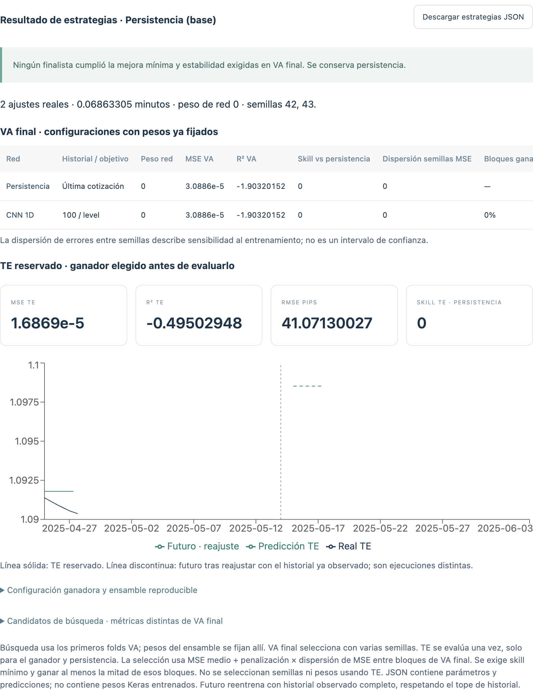

# Optimización por etapas · 1.8.0

En **Análisis y Simulación**, cargar una serie, seleccionar su variable y abrir **Optimización por etapas · R² → Configurar estrategias**. El panel tiene presupuesto rápido/amplio y ajuste libre. El botón de ejecución requiere comprobar primero el plan: número máximo estimado de ajustes, fechas y muestras de cada bloque.

## Protocolo temporal

La última ventana, del mismo tamaño que el horizonte, queda como TE. Los folds anteriores se dividen cronológicamente en dos grupos:

1. **VA de búsqueda:** primeros folds; eligen historial, objetivo y refinamiento. Dentro de cada TR externa, la red reserva el 10% final para su checkpoint/ES. Esa VA interna no es la VA externa de búsqueda.
2. **VA final:** últimos folds; compara configuraciones nominadas con varias semillas. Sigue siendo validación usada para seleccionar, no un segundo test independiente.
3. **TE:** se consulta una vez para el ganador ya fijado y persistencia. Después se puede reajustar el modelo para futuro usando las observaciones disponibles, incluido ese periodo ya observado.

Si ese TE ya se utilizó en otros experimentos, la reserva dentro de este cálculo no lo convierte en una nueva confirmación independiente. Es necesario reservar datos posteriores para una confirmación prospectiva.

## Etapas

### 1. Historial y objetivo

Familias CNN/RNN/LSTM, historiales 250/500/1000 y objetivos nivel/diferencia/log-retorno. La red base tiene una capa de 16 unidades, LR 0.0003 y dropout cero. El log-retorno se omite si los datos anteriores a TE no son positivos.

La selección rápida usa un subconjunto reproducible y reparte candidatos entre las familias. El plan lo indica; no se presenta como una búsqueda exhaustiva. Los historiales mayores que la primera TR disponible se omiten, en vez de fingir que se comparan distintos historiales al truncarlos al mismo tamaño.

### 2. Arquitectura, indicadores y scaler

Se refinan bases elegidas únicamente con VA de búsqueda: unidades, profundidad, ventana, LR, dropout, scaler X y conjunto de indicadores. El objetivo conserva Standard y la cotización se reconstruye antes de medir MSE/R².

- Mínimo: lag 1 y retorno.
- Compacto: lags 1/2, retorno y volatilidad.
- Tendencia: lags, EMA 10/20, RSI, retorno y volatilidad.

Las escalas y pesos se aprenden dentro de cada TR; no se reajustan con VA externa o TE.

### 3. Semillas y mezcla con persistencia

Se nomina la mejor configuración disponible por familia, hasta el límite de finalistas. Para cada una, se fija el peso de red usando exclusivamente sus predicciones de búsqueda:

`pronóstico = peso × red + (1 − peso) × última cotización conocida`

Peso cero es persistencia; uno es red sin mezcla. Los pesos no se retocan al observar VA final o TE. En VA final se promedian predicciones de todas las semillas; no se elige la semilla más afortunada.

El criterio es `MSE medio + penalización × desviación de MSE entre bloques`. Para ser elegible, la configuración también debe superar el skill mínimo frente a persistencia y ganar al menos la mitad de los bloques. Skill 0.01 significa reducción de MSE del 1%. La dispersión entre semillas describe sensibilidad; no es un intervalo de confianza.

Si ninguna red cumple las reglas, gana persistencia. Si fallan todos los candidatos, se informa el error y se conserva la referencia sin presentar una red fallida como ganadora.

## Resultados y límites

La pantalla separa MSE de búsqueda, MSE/R² de VA final y métricas de TE. Muestra peso elegido, sensibilidad a semillas, fracción de bloques ganados y motivos de exclusión. Los resultados permanecen en la sesión al navegar entre pantallas. Se exporta JSON con parámetros, semillas, fechas, auditorías de escalas, candidatos, errores y predicciones.

**El JSON no incluye pesos Keras entrenados.** Contiene una receta reproducible que requiere reajuste para obtener modelos. Los paquetes con pesos del banco de variantes siguen siendo una función distinta. Una búsqueda con muchas configuraciones puede tardar varios minutos o más; el plan muestra un límite de ajustes, no una estimación fiable de minutos. El contador real puede ser menor por caché, duplicados, errores o peso de red cero.

Las fechas futuras siguen la frecuencia declarada y no incorporan calendario exacto de intermediario/bolsa. Este módulo genera pronósticos; no envía órdenes.

## Verificación

Pruebas específicas: modificar TE no cambia el ganador, pesos elegidos solo con búsqueda, TE solo para el ganador, persistencia como respaldo, historial disponible, validación sin entrenamiento y serialización. La prueba Electron comprueba entradas incompletas, ejecución real, exportación y conservación de resultados al navegar.

