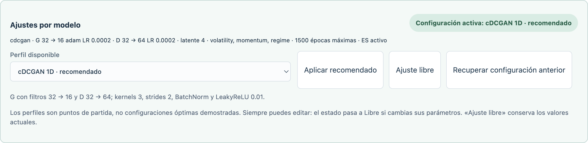

# Perfiles recomendados y ajuste libre · 1.6.0

El panel **Ajustes por modelo** aparece en el editor neuronal, en cada unidad del taller y en el banco de variantes. Las configuraciones existentes siguen en modo Libre hasta que se aplica un perfil explícitamente. Elegir una opción del desplegable no cambia valores: hay que pulsar **Aplicar recomendado**.

## Estado visible

- **Recomendado:** los campos gestionados por el perfil coinciden con sus valores aplicados.
- **Libre · modificado:** se editaron parámetros del perfil. Los controles permanecen disponibles.
- **Libre · personalizada:** configuración manual o botón **Ajuste libre**. Este botón conserva todos los valores actuales.

Se muestran capas/filtros, optimizador, LR y presupuesto, o el resumen específico de factores, condiciones o replay según la tarea. El perfil registra únicamente los parámetros que establece: cambiar fechas o tiempo máximo no altera la identificación del perfil de una unidad/red.

**Recuperar configuración anterior** deshace la última aplicación de un perfil dentro del panel abierto. Ese respaldo es temporal; la configuración activa de unidades y redes sí se guarda localmente y se recupera al recargar.

## Puntos de partida

| Modelo o tarea | Ajustes de referencia |
|---|---|
| MLP | Proyección 64 → oculta 32, ReLU, Adam 0.001, dropout 0.1 |
| CNN 1D | Ventana 20, filtros 32 → 64, kernel 3, padding causal |
| RNN | Ventana 10, 16 unidades tanh |
| LSTM / GRU | Ventana 20, 32 unidades tanh, compuertas sigmoid |
| BiLSTM / BiGRU | 32 unidades por dirección dentro de la ventana histórica |
| AE / DAE / PCA | Tres factores, encoder/decoder de 32; DAE con ruido 0.1 |
| CVAE | Latente 4, horizonte 16, beta KL 0.01 |
| cGAN | G 64 → 32, D 32 → 64, Adam 0.0002 independientes |
| cDCGAN 1D | G 32 → 16, D 32 → 64, kernels 3, strides 2, BatchNorm y LeakyReLU |
| DQN / Double DQN | Red de referencia 64 → 32, replay 10,000, lote 64, gamma 0.95 |
| Ridge / logística | Regularización de referencia 1; sin entrenamiento por épocas |

Los modelos supervisados y generativos parten de un techo de 1500 épocas con ES. U3 usa 100 épocas completas para comparar optimizadores y U4 usa 200 con la variante ES diferenciada. HPO prepara cuatro trials y dos folds anteriores a la validación externa. Los agentes utilizan diez episodios, no Early Stopping por épocas.

El GAN del editor general es un pronosticador de un paso y tiene su propio perfil: ruido 8, reconstrucción L1 10 y contexto 20. Los perfiles de GAN del taller generan ventanas de retornos; son tareas diferentes.

Son configuraciones iniciales para experimentar, no ganadores demostrados. La calidad debe medirse con la validación de los datos utilizados. El test queda reservado.

## Banco de variantes

Hay 24 perfiles de búsqueda, uno por familia y tarea compatible. Aplicar uno selecciona **una sola familia** y prepara tres variantes, anchos/profundidades, optimizadores y rango de LR. Las arquitecturas concretas se muestrean del espacio visible; el perfil de búsqueda no fija una arquitectura ganadora.

Para comparar varias familias simultáneamente, pulsar **Ajuste libre**, marcar las familias y ajustar el espacio común. El panel muestra las familias activas y el espacio de búsqueda. Modificar este espacio cambia el estado a Libre. En el banco se compara el conjunto completo del perfil aplicado, incluida su configuración base.

## Reproducibilidad

Los perfiles no modifican los datasets ni las fechas al aplicarse. Pueden establecer indicadores, condiciones, arquitectura, presupuesto y selección de modelos: estos cambios se ven inmediatamente y exigen comprobar de nuevo antes de entrenar.

Los resultados y exportaciones registran `configurationProfile`: identificador, etiqueta, ámbito, modo y valores del perfil de origen. Si hubo cambios manuales, la ejecución se registra como Libre, conservando la referencia de origen. Los parámetros efectivos permanecen en el JSON y en el manifiesto de inferencia. El resultado muestra el perfil de esa ejecución aunque se cambien después los controles.

## Verificación

- Catálogo: 14 perfiles del taller, cinco redes y 24 perfiles del banco.
- Pruebas del estado recomendado/libre, cambios, recuperación, persistencia y conservación de fechas.
- Todos los perfiles del taller/banco pasan el preflight real con la demo diaria.
- Prueba Electron con perfiles, cambio de unidad, recarga, búsqueda cDCGAN, entrenamiento y exportación JSON que conserva origen y modo Libre tras editar.

