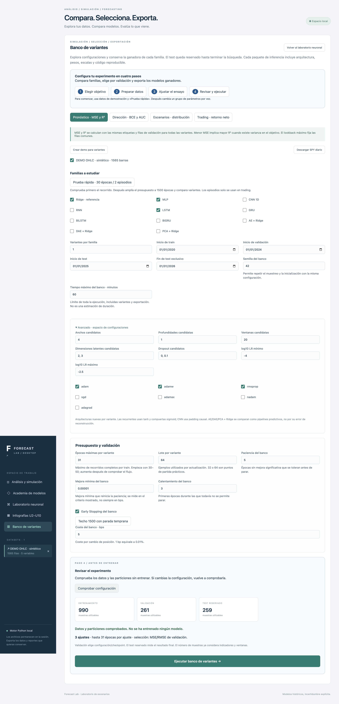

# Configuración guiada de experimentos · 1.4

La revisión de uso detectó formularios extensos, parámetros sin explicación, errores de datos descubiertos al entrenar y selección implícita del primer activo en trading. El cambio organiza el banco de variantes y las nueve unidades del taller en cuatro pasos con navegación directa:

1. **Objetivo:** elegir tarea/familias o unidad. Se explica qué métrica sirve para seleccionar: MSE/R² para pronósticos, BCE para dirección, distribución para escenarios y retorno neto para trading.
2. **Datos:** crear demo sintética o descargar/seleccionar OHLC diarios. Las fechas deben seguir train < validación < test < fin exclusivo.
3. **Ensayo:** conservar el preset, empezar con «Prueba rápida» y ajustar después. La prueba rápida configura 30 épocas, ES, paciencia 5 y calentamiento 3; en agentes, 2 episodios. En el banco reduce a una variante por familia, ancho 32 y profundidad 1. No certifica calidad predictiva.
4. **Revisión:** «Comprobar configuración» prepara indicadores/ventanas y muestra los tamaños exactos de train, validación y test. No entrena modelos. Solo una comprobación vigente habilita ejecutar.

Los parámetros numéricos disponen de ayuda sobre significado y efecto. El banco agrupa el espacio de búsqueda en un desplegable avanzado. El editor general explica cómo elegir red, incluirla en la comparación, definir características y volver al análisis para ejecutar.

## Prevención de errores

- Editar cualquier entrada invalida la comprobación, incluso si el campo todavía no ha confirmado su valor al perder foco.
- Las listas incompletas, campos fuera de rango, fechas incoherentes, selección vacía y ausencia de datos bloquean el entrenamiento con un mensaje.
- Trading exige exactamente un activo; ya no descarta silenciosamente los restantes.
- La revisión comprueba ventanas CNN, folds internos HPO, presupuesto del replay y compatibilidad de familias. Informa si el calentamiento impide la parada temprana o si se solicita un presupuesto largo sin ES.
- Se informa cuando la configuración cambió desde la ejecución anterior. Las exportaciones conservan los parámetros originales del resultado.

La comprobación es una ayuda previa, no una garantía de convergencia o disponibilidad futura de memoria. El motor sigue validando al ejecutar. Los periodos y métricas mantienen la separación cronológica existente; no se elige un modelo usando test.

## Implementación y verificación

`ExperimentGuide` y `ExperimentReview` comparten el recorrido y el control de vigencia. `experimentHelp.ts` centraliza las explicaciones. `preview_experiment` reutiliza las funciones de datos del entrenamiento, sin efectuar actualizaciones de pesos.

- Build de TypeScript y Vite aprobado.
- 78 pruebas Python aprobadas, incluidas 11 nuevas de revisión previa.
- `npm run smoke:guide`: navegación, prueba rápida, bloqueo inicial, invalidación al editar, listas incompletas y fechas incorrectas.
- `npm run smoke:emulator`: entrenamiento real, ES activo/inactivo, JSON, paquetes ZIP e inferencia con pesos recargados.
- `npm run smoke:units`: revisión y ejecución de las nueve unidades, métricas y exportación JSON.

