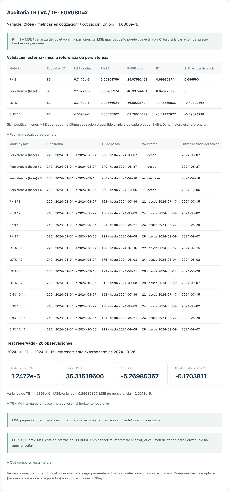

# Revisión MSE, R², TR/VA/TE y escaladores · 1.7.0

## Hallazgos en EURUSD=X

El cálculo original de MSE/R² operaba sobre la cotización desescalada. El error de presentación estaba en el formateador compartido: tres decimales hacían que errores no nulos pequeños se vieran como cero. Se reemplazó por precisión ampliada y notación científica para valores pequeños.

En la reproducción, MSE = **0.000370658998635** podía mostrarse como **0**, aunque RMSE = **192.53 pips**. No es un ajuste perfecto.

R² compara contra la media del bloque evaluado: `R² = 1 − MSE / varianza(y)`. En este TE, varianza = 0.00031795872431; MSE/varianza = 1.165746; R² = **-0.165746**. La varianza también es pequeña: por eso el MSE en cotización² no se interpreta por su magnitud aislada. Un pip de EURUSD se toma como 0.0001.

El skill contra persistencia compara contra una predicción causal: mantener la última cotización disponible antes del bloque. Puede ser positivo aunque R² sea negativo, porque la media de TE usada en R² no se conoce al pronosticar.

No se encontró ajuste de escalas con VA/TE en las redes generales: el ajuste ya se hacía en TR interna. Sí existía una diferencia de protocolo que ahora se muestra: los checkpoints usan validación interna de un paso con contexto observado; VA externa y TE son recursivos. Además, por defecto VA podía tener seis pasos y TE hasta sesenta: sus errores no son directamente intercambiables.

## Reproducción con los 14 métodos

Datos diarios de Yahoo Finance, 1299 barras desde 2021-10-29 hasta 2026-10-28. Se excluyó la fecha UTC actual para evitar usar la barra de ese día. Variable Close. Tres folds externos × 20 pasos = 60 etiquetas VA. TE reservado = 60 pasos (2026-08-06 a 2026-10-28). Todos los métodos comparten etiquetas y horizonte por bloque.

Presupuesto acotado: redes de 16 unidades, máximo 40 épocas, ES paciencia 8, LR 0.0003; redes RNN/CNN/LSTM/GAN con objetivo log-retorno reconstruido y entradas Robust. DQN y Q-Learning usan diez episodios. Los métodos clásicos mantienen su preparación causal propia. No es una optimización exhaustiva ni una comparación con el archivo exacto de la sesión del usuario.

| Método | MSE VA · cotización² | RMSE VA · pips | R² VA | Skill vs persistencia |
|---|---:|---:|---:|---:|
| cnn | 5.01869861e-05 | 70.84 | 0.5193 | 52.39% |
| garch | 9.99818009e-05 | 99.99 | 0.0423 | 5.16% |
| qlearning | 0.000102849863 | 101.41 | 0.0149 | 2.43% |
| monte_carlo | 0.00010354898 | 101.76 | 0.0082 | 1.77% |
| naive | 0.00010541659 | 102.67 | -0.0097 | 0.00% |
| arima | 0.00010849707 | 104.16 | -0.0392 | -2.92% |
| sarima | 0.000108548001 | 104.19 | -0.0397 | -2.97% |
| rnn | 0.000114874706 | 107.18 | -0.1003 | -8.97% |
| dqn | 0.00012729175 | 112.82 | -0.2193 | -20.75% |
| gan | 0.000141912525 | 119.13 | -0.3593 | -34.62% |
| lstm | 0.000161797181 | 127.20 | -0.5498 | -53.48% |
| linear | 0.000174233853 | 132.00 | -0.6689 | -65.28% |
| prophet | 0.000332138841 | 182.25 | -2.1814 | -215.07% |
| polynomial | 0.00273112013 | 522.60 | -25.1598 | -2490.79% |

Los 14 métodos finalizaron sin errores de ejecución. **CNN** obtuvo el menor MSE de VA en esta prueba. Se evaluó TE únicamente para ese ganador: RMSE **192.53 pips**, R² **-0.1657** y reducción de MSE frente a persistencia **6.98%**. Esa ventaja es de una sola partición y no demuestra estabilidad ni rentabilidad.

El TE de 60 pasos es más largo que cada bloque VA de 20: esta limitación se conserva visible en el reporte. La nueva configuración Forex permite alinear ambos a 20; esa evaluación sería otro experimento y no se utilizó para retocar este resultado.

## Comparación adicional RNN/LSTM, solo con VA

| Red | Objetivo | Scaler X | RMSE VA · pips | R² VA |
|---|---|---|---:|---:|
| rnn | level | standard | 124.75 | -0.4906 |
| rnn | difference | robust | 106.16 | -0.0794 |
| rnn | log_return | robust | 107.18 | -0.1003 |
| lstm | level | standard | 195.57 | -2.6633 |
| lstm | difference | robust | 129.03 | -0.5947 |
| lstm | log_return | robust | 127.20 | -0.5498 |

Cambian objetivo y scaler en la comparación nivel/retorno; no se puede atribuir toda la diferencia a un solo factor. Los cambios redujeron error frente al ajuste directo en nivel en esta reproducción, pero RNN/LSTM todavía no superaron a persistencia. Es una mejora parcial, no una solución validada superior a la referencia.

## Cambios de la aplicación

- MSE no nulo pequeño se muestra con notación científica. No se modifica artificialmente R² ni se transforma su valor para acercarlo a uno.
- Panel de auditoría en Análisis y Simulación: variable/unidad, pips, folds, fechas TR, VA interna, VA externa y TE, último dato usado por el scaler y comparación con persistencia.
- Botón **Preparar Forex · persistencia + RNN + LSTM + CNN**: selecciona Close, cuatro folds de 20, TE de 20, redes compactas, 500 observaciones recientes, VA interna 10%, log-retorno y Robust X. Es un punto de partida editable, no un óptimo demostrado.
- TE reservado configurable; desactivar horizontes adicionales evita ajustes que no pertenecen al experimento principal.
- Objetivo de redes: nivel, diferencia o log-retorno. Siempre se reconstruye la cotización antes de calcular MSE/R² externos. Log-retorno requiere precios positivos.
- Scalers X/y: Standard, Robust, MinMax y ninguno; ajuste solo con TR. MinMax no recorta automáticamente valores VA/TE fuera del rango de TR. En clasificación, las etiquetas BCE siguen siendo 0/1.
- Las barras diarias descargadas excluyen la fecha UTC actual de forma conservadora.
- Tendencia/estacionalidad/residuo se nombran explícitamente: ya no se confunden con las particiones TR/VA/TE.
- En taller/banco: métricas TR/VA/TE, MSE normalizado separado del original, skill contra media de TR, drift, constantes y fechas por activo. Los scalers de ventanas cuentan una sola vez cada fila histórica repetida.
- Se corrigió la activación/dropout de la primera capa oculta MLP cuando se desactiva la proyección de entrada.
- Indicadores opcionales conocidos al cierre: retorno actual, intradía actual y gap actual. Los once originales y los experimentos guardados se mantienen disponibles.
- Demo con señal controlada para comprobar aprendizaje; se distingue de la demo original de ruido. Obtener R² alto en la demo controlada no prueba capacidad de anticipar Forex.

## Procedimiento recomendado

1. Elegir la variable que se desea pronosticar y el horizonte real de uso. Comparar primero persistencia; no confundir error de una cotización con error de un retorno.
2. Mantener las mismas fechas al comparar nivel/diferencia/log-retorno y Standard/Robust. El escalado afín correcto no cambia R² de predicciones ya dadas, aunque puede cambiar el resultado de reentrenar una red o una regresión regularizada.
3. Revisar TR contra VA: si TR mejora y VA empeora, probar menos parámetros, regularización moderada y ES. Si ambas son pobres, revisar señal, objetivo, LR y referencia antes de aumentar épocas.
4. Usar más orígenes temporales y distintas semillas para comprobar estabilidad. Si ninguna configuración supera persistencia en VA, conservar la referencia como elección práctica.
5. Reservar TE. No volver a elegir ajustes basándose repetidamente en ese mismo TE: se convierte de hecho en validación. Para confirmación adicional, reservar un periodo nuevo.
6. R² cercano a 1 no es un objetivo razonable impuesto al código para cualquier precio y horizonte. Un resultado inusualmente perfecto exige revisar anticipación, alineación y unidades.

Los resultados completos están en los JSON de auditoría. El repositorio incluye un resumen sin toda la serie de cotizaciones.

